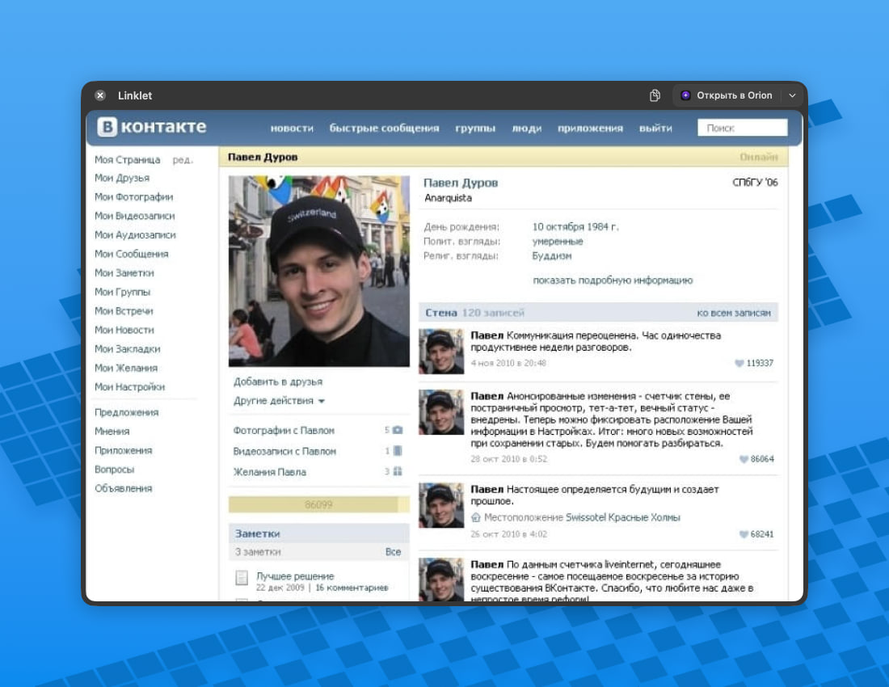

<div align="center">
  

  <h1>Linklet</h1>

  <p><strong>Сначала посмотрите ссылку — затем решите, где её открыть.</strong></p>

  <p>Нативный роутер ссылок и быстрый WebKit‑просмотрщик для macOS.</p>

  <p><a href="#установка">Установка</a> · <a href="#возможности">Возможности</a> · <a href="#разработка">Разработка</a> · <a href="#устройство-проекта">Устройство проекта</a></p>
</div>

<p align="center">
  
</p>

## Что делает Linklet

Linklet становится обработчиком HTTP(S)-ссылок в macOS. Ссылка из Почты, Telegram,
Slack или другого приложения сначала открывается в компактном окне поверх текущей
задачи. В нём можно быстро оценить страницу, перейти назад или вперёд, скопировать
текущий адрес — либо открыть исходную ссылку в выбранном браузере или профиле Orion.

Это именно отдельный WebKit‑просмотр: авторизация, вкладки, расширения, позиция
прокрутки и история браузера в него не переносятся. При выборе браузера Linklet
передаёт первоначальную внешнюю ссылку, а браузер загружает её в собственном профиле.

## Установка

Готовые сборки находятся на странице [GitHub Releases](https://github.com/alybo/Linklet/releases).
Скачайте актуальный `.dmg`, перенесите Linklet в «Программы», запустите
его и в настройках нажмите «Использовать по умолчанию». Требуется macOS 14 или новее.

## Возможности

- Предпросмотр HTTP(S)-ссылок в отдельном окне с навигацией, жестами трекпада,
  сочетаниями `⌘[` / `⌘]`, копированием адреса и закрытием по `Esc`.
  Нажатие на домен или `⌘L` открывает редактор адреса; `⌘F` — поиск по странице,
  `⌘R` — обновление, `⌘+`, `⌘−` и `⌘0` — управление масштабом.
  Окна, открываемые сайтами, имеют то же оформление и перемещаются независимо,
  сохраняя связь с исходной страницей и общую сессию для авторизации.
- По умолчанию новая ссылка заменяет содержимое текущего окна. В «Окна и панель» можно
  выбрать режим нескольких окон: тогда каждая новая входящая ссылка открывается
  в собственном окне, а следующие окна слегка смещаются относительно предыдущего.
  Linklet запоминает позицию и размер окна для каждого точного домена и восстанавливает
  их при следующем открытии; если прежний экран недоступен, окно остаётся в видимой
  области текущего экрана.
- Linklet появляется в Dock, когда открыто хотя бы одно окно просмотра или
  «Настройки», и остаётся приложением из menu bar, когда окон нет. Контекстное меню
  в Dock показывает нативный список окон и команду «Закрыть все окна» — она закрывает
  окна, но не завершает Linklet.
- Открытие ссылки в установленном браузере; отдельно обнаруживаются профили Orion.
  Браузеры можно скрывать, ранжировать по использованию или вручную упорядочивать.
- Быстрый поиск: меню или настраиваемое сочетание клавиш открывает стеклянную
  панель. Поддержаны Google, Яндекс, DuckDuckGo и Bing; веб‑адрес открывается
  напрямую, остальной текст ищется. Закладки хранятся локально и редактируются
  в боковой панели: плитки открывают обычный предпросмотр, сортируются перетаскиванием,
  временно скрываются без удаления. Иконки сайтов загружаются автоматически и общие
  для поиска, боковой панели и истории; после каждой загрузки страницы проверяется
  их обновление.
- Глобальная боковая панель у левого края экрана по умолчанию включена в новом
  профиле и открывается при наведении на край; сохранённое пользователем отключение
  учитывается. В панели — закладки и папки с перетаскиванием, сворачиваемые разделы
  с изменением порядка. История показывается
  по 10 ссылок с кнопкой «Показать ещё»; повторное открытие восстанавливает последний
  адрес страницы и позицию прокрутки. Раздел «Открытые» переключает живые окна
  без перезагрузки и позволяет закрывать их. Состояние раскрытия папок сохраняется.
  В быстром поиске те же закладки показываются
  без папок, в общем порядке. Размеры текста и иконок следуют системному размеру боковых панелей macOS.
  Чёрная панель с закруглёнными плечами у неподвижного края экрана вызывается
  наведением на левый край с настраиваемой задержкой, сочетанием ⌃⌥B или из меню.
  Индикатор открытия опционален; очистка истории требует подтверждения в панели.
  Ширина меняется за правый край, сохраняется и ограничена четвертью экрана.
  В настройках доступны экспериментальное стеклянное оформление на macOS 26+
  и отключение панели поверх полноэкранных приложений.
- Сохранение файлов и изображений со страницы с прогрессом загрузки в боковой
  панели. История последних 200 загрузок сохраняется между запусками и показывается
  по 10 записей с кнопкой «Показать ещё». Очистка истории удаляет записи, сохраняя
  файлы и активные передачи. Отправка файлов на сайт через нативный диалог или перетаскивание.
- Меню других браузеров открывается стрелкой справа от адреса страницы. В нём
  перечислены все выбранные браузеры, основной доступен по ⌘1. В настройках
  «Поиск и браузеры» можно включить прежнюю кнопку «Открыть в браузере».
- Разрешения камеры, микрофона и геолокации для каждого сайта с проверкой
  системного доступа macOS и управлением в настройках данных сайтов.
- Необязательное расширение Raycast: ищет выделенный текст через настроенный в
  Linklet поисковик. Инструкция — в [интеграции Raycast](integrations/raycast-linklet/README.md).
- Приватность по умолчанию: связанные окна сайта используют временную сессию,
  которая очищается после закрытия последнего связанного окна. Можно явно включить локальное сохранение входов и настроек,
  удалить данные отдельного сайта или настроить автоочистку.
  Сохранённые размеры и позиции окон — отдельная локальная настройка интерфейса:
  они не содержат данные сайта и не удаляются вместе с cookies или кэшем.
  Закладки, история просмотров и загрузок хранятся в пользовательском профиле
  отдельно от `Linklet.app` и не включаются в сборку приложения. История загрузок
  содержит метаданные файла и URL, без cookies, POST-тел и данных возобновления.
- Необязательный блокировщик рекламы на фильтрах AdGuard. Базовые списки поставляются
  с приложением; успешные обновления фильтров проверяются не чаще раза в сутки.
  Блокировку для текущего сайта можно переключить в контекстном меню страницы;
  страница обновляется автоматически.
- Русский, английский и системный язык; запуск при входе в macOS; три режима окна
  при переключении между приложениями; нативное знакомство с интерактивными подсказками.
  Первая ссылка открывается сразу с временными данными; на финальном экране знакомства
  можно открыть быстрый поиск или настройки.
- Проверка обновлений через Sparkle. Автоматическая проверка включена по умолчанию,
  а скачивание и установка всегда требуют подтверждения.

## Разработка

Проект — нативное приложение SwiftUI/AppKit для macOS 14+, расположенное в
`Linklet/Linklet.xcodeproj`. Зависимости SwiftPM зафиксированы в
`Package.resolved`: Sparkle 2.9.6 и SafariConverterLib для преобразования фильтров
AdGuard.

Откройте `Linklet/Linklet.xcodeproj` в Xcode, выберите схему **Linklet** и
запустите `⌘R`. Для проверки без назначения браузером по умолчанию:

```sh
open -a Linklet "https://example.com"
```

Полный набор тестов:

```sh
xcodebuild -project Linklet/Linklet.xcodeproj -scheme Linklet -sdk macosx test CODE_SIGNING_ALLOWED=NO
```

Для расширения Raycast необходим Node.js 22.6+; команды проверки перечислены в
его [README](integrations/raycast-linklet/README.md#checks).

## Устройство проекта

| Путь | Назначение |
| --- | --- |
| `Linklet/Linklet/App` | Точка входа, menu bar и жизненный цикл приложения. |
| `Linklet/Linklet/State` | Оркестрация состояния приложения и сессии предпросмотра. |
| `Linklet/Linklet/Services` | Ссылки, браузеры и Orion, поиск, данные сайтов, AdGuard, Sparkle. |
| `Linklet/Linklet/UI` | SwiftUI/AppKit-интерфейс предпросмотра, поиска и настроек. |
| `Linklet/LinkletTests` | Unit- и WebKit‑тесты ключевых сценариев. |
| `integrations/raycast-linklet` | Неопубликованное расширение Raycast на TypeScript. |
| `updates/` и `scripts/` | Лента Sparkle и подготовка подписанного обновления. |
| `Linklet/docs/` | Продуктовые заметки, дизайн, выпуск, обновления и передача подписи. |

Для устойчивой работы с Codex в корне есть компактный [AGENTS.md](AGENTS.md): он
автоматически добавляет архитектурный контекст и правила проверки в новый чат.
Держите в нём только стабильные рабочие договорённости, а детали конкретной задачи
пишите в первом сообщении нового чата.

## Документация

- [Изменения версии 1.6](Linklet/docs/releases/1.6.md)
- [Технические детали приложения](Linklet/README.md)
- [Краткое описание продукта](Linklet/docs/PRODUCT.md)
- [Обновления и выпуск](Linklet/docs/UPDATES.md)
- [Процесс выпуска и роли](Linklet/docs/RELEASE-WORKFLOW.md)
- [Передача подписи](Linklet/docs/SIGNING-HANDOFF.md)
- [Лицензирование релизов](RELEASING.md)

## Лицензия

Исходный код распространяется по [GNU GPL v3](LICENSE).

<div align="center"><sub>Linklet · простой способ не открывать ссылку вслепую</sub></div>
